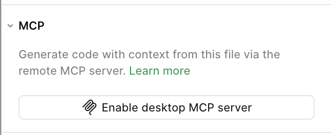

# Contribution Guide

Руководство описывает структуру репозитория, создание и перенос компонентов, проверки и локальное подключение пакетов к приложению.

## Как устроен репозиторий

Рабочая область pnpm объединяет пакеты дизайн-системы в `packages/*` и приложения в `apps/*`.

```
design-system/
├── packages/                      # Публикуемые npm-пакеты @ds/*
│   └── <pkg>/
│       ├── src/<Name>/            # nested-раскладка по компоненту
│       ├── stories/<Name>/        # Playground + VisualMatrix
│       ├── demos/                 # <Name>Demo.tsx для docs
│       ├── docs/                  # index.mdx + props.json
│       └── __test__/<Name>/       # Playwright specs + __snapshots__/
├── apps/
│   ├── storybook/                 # Storybook 10
│   └── docs/                      # Astro + Starlight
├── playwright/                    # Корневые fixtures, constants, utils
├── playwright.config.ts           # Сканирует packages/**/__test__/**/*.spec.ts
├── tsconfig.base.json             # Единый источник общих compilerOptions
├── tsconfig.json                  # Typecheck-профиль (noEmit)
├── packages/tsconfig.esm.json     # Оркестратор ESM-сборки (project references)
├── packages/tsconfig.cjs.json     # Оркестратор CJS-сборки
├── scripts/
│   ├── add-package.mts            # Создаёт новый пакет и подключает его к репо
│   ├── add-package/               # scaffold.mts, wire.mts
│   ├── gen-props.mts              # docs/props.json из типов
│   └── gen-readme.mts             # README.md из MDX
└── .agents/skills/                # Общие навыки для агентов
```

Пакеты и приложения используют общие инструменты сборки.

- pnpm разрешает ссылки между пакетами рабочего пространства.
- Корневые скрипты (`package.json`) — сборка пакетов: `tspc` (ESM + CJS) → SCSS/CSS → обработка CSS Modules в сборке CJS.
- `lerna` — только для версий и публикации в npm (independent).

## Быстрый старт

```bash
pnpm deps
pnpm exec playwright install         # браузеры для Playwright

pnpm dev:storybook                   # localhost:6006
pnpm dev:docs                        # localhost:4321
pnpm dev                             # оба параллельно
```

## Анатомия пакета

Структура зависит от публичных компонентов и внутренних модулей. Сохраняйте существующее расположение файлов при переносе. Для нового пакета выберите плоскую или вложенную структуру. Подробности — в [`.agents/skills/component-development/references/package-src-structure.md`](https://github.com/cloud-ru-tech/snack-v2/blob/master/.agents/skills/component-development/references/package-src-structure.md) и [`.agents/skills/new-component-package/references/reference-package-anatomy.md`](https://github.com/cloud-ru-tech/snack-v2/blob/master/.agents/skills/new-component-package/references/reference-package-anatomy.md).

```
packages/<pkg>/
├── src/
│   ├── <Name>/
│   │   ├── <Name>.tsx
│   │   ├── constants.ts
│   │   ├── types.ts
│   │   ├── styles.module.scss
│   │   └── index.ts               # export * from './<Name>'
│   └── index.ts                   # export * по секциям
├── stories/
│   └── <Name>/
│       ├── <Name>.Playground.stories.tsx     # обязателен
│       ├── <Name>.VisualMatrix.stories.tsx   # обязателен
│       ├── testIds.ts                        # если id повторяются в 2+ местах
│       ├── examples/                         # появляется только если в ней есть story
│       │   └── <Name>.<Scenario>.stories.tsx # сценарии, копируемые потребителем
│       └── tests/                            # появляется только если в ней есть story
│           └── <Name>.<Scenario>.stories.tsx # InteractionTest и т.п. — только тест-обвязка
├── __test__/
│   └── <ParentComponent>/                    # папка основного компонента
│       ├── helpers.ts
│       ├── rendering.spec.ts                 # всегда
│       ├── visual.spec.ts                    # всегда
│       ├── interaction.spec.ts               # для сценариев с отдельными API браузера
│       ├── keyboard.spec.ts                  # для сложных сценариев клавиатуры
│       ├── polymorphism.spec.ts              # если есть `as`
│       └── __snapshots__/                    # эталонные снимки рядом со spec
├── demos/
│   ├── <Name>Demo.tsx
│   └── examples/<Example>.tsx                # для MDX через ?raw
├── docs/
│   ├── index.mdx
│   └── props.json                            # автоген: pnpm gen:props
├── package.json
├── tsconfig.json
├── tsconfig.esm.json
├── tsconfig.cjs.json
└── README.md                                 # автоген: pnpm gen:readme
```

### Примеры для документации

`demos/examples/<Example>.tsx` содержит самостоятельный React-пример для блока `<Example>`. MDX импортирует компонент с `client:visible` и исходник через `?raw`. Читатель видит результат и может скопировать код вместе с импортами.

`demos/<Name>Demo.tsx` нужен для секции «Демо», когда параметры компонента можно настраивать через `Canvas` без сценария с состоянием. Если смысл примера зависит от взаимодействия, покажите его в «Примерах использования». [Структура страниц MDX](https://github.com/cloud-ru-tech/snack-v2/blob/master/.agents/skills/component-docs/references/docs-structure.md)

В пакете с несколькими публичными компонентами у каждого свой набор stories. Автономные компоненты с собственным публичным API получают отдельную папку E2E. Варианты основного компонента проверяются через его stories и параметры тестов.

### Зависимости пакета

- Указывайте диапазон с `^` для внешних зависимостей, которые получает потребитель пакета. Для `devDependencies` фиксируйте точную версию.
- Используйте `catalog:` для общих версий из `pnpm-workspace.yaml` и `workspace:^` для внутренних зависимостей публикуемых пакетов. Приложения используют `workspace:*`.
- React и его типы предоставляет корневое рабочее пространство. В манифест пакета `react`, `react-dom` и `@types/react*` не добавляются.

[Правила объявления зависимостей](https://github.com/cloud-ru-tech/snack-v2/blob/master/.agents/skills/new-component-package/references/packages-deps.md)

### package.json — exports

```json
{
  "name": "@ds/example",
  "exports": {
    ".": {
      "source": "./src/index.ts",
      "types": "./dist/esm/index.d.ts",
      "import": "./dist/esm/index.js",
      "require": "./dist/cjs/index.js"
    }
  }
}
```

По полю `source` Storybook и портал находят исходный код пакета. Скомпилированный модуль подключает стили компонента при импорте.

## Как работают стили

`styles.module.scss` + токены `@ds/figma-variables`:

```scss
@use '@ds/figma-variables/build/scss/styles/styles.module' as base;

.root {
  background: base.$sn-theme-color-primary-accent;
}
```

CSS Modules — `camelCaseOnly` (`styles.primaryVariant`, не `styles['primary-variant']`). SCSS компилируется рядом с JS в `dist/esm` и `dist/cjs`.

## Storybook (версия 10)

Storybook автоматически загружает `packages/*/stories/**/*.stories.tsx` — ручной регистрации нет.

```bash
pnpm dev:storybook
```

### Формат stories

Описывайте stories объектами CSF3. Используйте `Meta<typeof Component>` для метаданных и `StoryObj<typeof Component>` для story. Импортируйте утилиты проверок из `storybook/test`. [Справка по CSF](https://storybook.js.org/docs/api/csf)

### Структура stories — Playground + VisualMatrix

Полные правила: [`.agents/skills/component-story-set/references/stories-standard.md`](https://github.com/cloud-ru-tech/snack-v2/blob/master/.agents/skills/component-story-set/references/stories-standard.md). Каждый компонент получает минимум **два** файла. В примере `testIds.ts` рядом с Playground экспортирует `TEST_IDS = { root: 'example' } as const`. Если идентификаторы общие для нескольких компонентов пакета, файл располагается в `stories/`.

```tsx
// packages/<pkg>/stories/<Name>/<Name>.Playground.stories.tsx
import { Meta, StoryObj } from '@storybook/react';
import { expect, within } from 'storybook/test';
import { APPEARANCE, Example, SIZE } from '@ds/example';
import { DemoPage, DemoPanel } from '#storybook/components';

import { TEST_IDS } from './testIds';

const meta: Meta<typeof Example> = {
  title: 'Components/Example',
  component: Example,
  parameters: { layout: 'fullscreen' },
  render: args => (
    <DemoPage>
      <DemoPanel>
        <Example {...args} />
      </DemoPanel>
    </DemoPage>
  ),
  args: {
    label: 'Example',
    appearance: APPEARANCE.Primary,
    size: SIZE.M,
    'data-test-id': TEST_IDS.root,
  },
};
export default meta;
type Story = StoryObj<typeof Example>;

export const Playground: Story = {
  tags: ['dev', 'test'],
  play: async ({ canvasElement }) => {
    await expect(within(canvasElement).getByTestId(TEST_IDS.root)).toBeVisible();
  },
};
```

`Playground` показывает публичные параметры компонента. Storybook выводит Controls из типов и JSDoc. Добавляйте `argTypes`, когда нужны пресеты, условная видимость или переопределение контрола. В `VisualMatrix` используйте `StoryTable` для визуально различимых вариантов. [Стандарт stories](https://github.com/cloud-ru-tech/snack-v2/blob/master/.agents/skills/component-story-set/references/stories-standard.md)

Используйте стабильные `data-test-id` для элементов, которые адресуют тесты. Повторяющиеся идентификаторы stories храните в `testIds.ts`. Если идентификатор — часть контракта внутреннего слота компонента, объявите его в публичном `TEST_IDS`.

### Подпапки `examples/` и `tests/`

- `examples/` содержит сценарии, которые разработчик может перенести в своё приложение.
- `tests/` содержит истории с тестовыми данными, имитациями обработчиков или действиями для проверки. Связанные проверки клика, клавиатуры и фокуса объединяйте через `step()` в `InteractionTest`.

Добавляйте story, если сценарий требует собственной композиции или состояния и его ещё нельзя показать через `args`, `StoryTable` или существующий `play`. При переносе story проверьте результат в манифесте Storybook по `/index.json` и обновите ссылки в тестах и MDX. [Критерий обоснованности артефакта](https://github.com/cloud-ru-tech/snack-v2/blob/master/.agents/skills/new-component-package/references/complexity-tiers.md)

### Компоненты с триггером

В Playground портального компонента храните `open` в локальном состоянии. Кнопки открытия используют `Button` из `@ds/button`. Основная кнопка сохраняет `triggerOpen`, дополнительные получают уникальные ключи `triggerOpen<Scenario>` в общем `TEST_IDS`. Используйте `layout: 'fullscreen'`. Если выбранная комбинация параметров невозможна, покажите применённое значение в `<DemoWarning>`. [Stories с триггером](https://github.com/cloud-ru-tech/snack-v2/blob/master/.agents/skills/component-story-set/references/trigger-based-stories.md)

## Документационный портал

Портал в `apps/docs/` построен на Astro. Маршрут зависит от расположения MDX-файла.

| Источник                               | URL                            |
| -------------------------------------- | ------------------------------ |
| `packages/*/docs/*.mdx`                | `/components/<pkg>/<filename>` |
| `apps/docs/src/content/patterns/*.mdx` | `/patterns/<filename>`         |

### Доменная группировка пакетов

Главная страница и боковая панель группируют пакеты по **префиксу имени**. Конфигурация — [`apps/docs/src/config/domains.ts`](https://github.com/cloud-ru-tech/snack-v2/blob/master/apps/docs/src/config/domains.ts):

| Префикс пакета    | Домен в портале и Storybook |
| ----------------- | --------------------------- |
| `uikit-product-*` | Uikit Product               |
| `ai-*`            | AI                          |
| `admin-*`         | Admin                       |
| (остальное)       | Snack                       |

`resolveDomain(pkg)` выбирает первое совпадение по префиксу. Порядок записей задаёт порядок секций на главной странице и в боковой панели. Поле `description` используется в описании секции и в подсказке рядом с названием группы.

### Категории внутри домена

Категории задаются в `CATEGORIES_BY_DOMAIN`. Добавьте имя пакета без `@ds/` в список `packages` подходящей категории. Если категория не указана в домене, который использует категории, пакет отображается в «Other», а сборка выводит предупреждение. [Конфигурация категорий](https://github.com/cloud-ru-tech/snack-v2/blob/master/apps/docs/src/config/categories.ts)

### Canvas, PropsTable, StorybookEmbed, FigmaEmbed

```mdx
import { ExampleDemo } from '../demos/ExampleDemo';
import { PropsTable } from '#docs/components/PropsTable';
import { StorybookEmbed } from '#docs/components/StorybookEmbed';
import { FigmaEmbed } from '#docs/components/FigmaEmbed';
import { figmaNode } from '#docs/lib/figma';
import exampleDoc from './props.json';

<ExampleDemo client:visible />
<StorybookEmbed storyId='components-example--playground' />
<FigmaEmbed node={figmaNode('example')} />
<PropsTable data={exampleDoc.Example} />
```

`Canvas` строит контролы из `props.json` (`componentDoc`). `FigmaEmbed` получает `FigmaNodeRef` через `figmaNode(pkg, sub?)` из `apps/docs/src/lib/figma.ts` . Узлы перечислены в `FIGMA_NODES` по имени пакета.

Полный шаблон MDX-страницы — [`.agents/skills/component-docs/references/docs-structure.md`](https://github.com/cloud-ru-tech/snack-v2/blob/master/.agents/skills/component-docs/references/docs-structure.md).

## Как добавить новый компонент

### Создание пакета через `pnpm add-package`

```bash
pnpm add-package
```

Команда требует интерактивный терминал. Скрипт создаёт файлы пакета, добавляет ссылки на проект в конфигурации сборок ESM и CJS и регистрирует зависимость в `apps/storybook/package.json`. Storybook и Astro определяют алиасы по исходникам и манифестам пакетов. Для просмотра будущих изменений используйте `pnpm add-package --dry-run`.

После создания пакета установите зависимости, сгенерируйте метаданные и откройте приложения для проверки.

```bash
pnpm deps
pnpm gen
pnpm dev
```

## Тестирование

| Проверка                                                 | Где выполняется                                      |
| -------------------------------------------------------- | ---------------------------------------------------- |
| Клик, клавиатура, фокус и вызовы обработчиков            | Storybook `play`                                     |
| Рендеринг и отражение ключевых значений пропсов в DOM    | Playwright `rendering.spec.ts`                       |
| Сценарии с API браузера, сложная навигация и полиморфизм | Соответствующий файл Playwright при наличии сценария |
| Снимки VisualMatrix и визуально отличимых состояний      | Playwright `visual.spec.ts`                          |
| Утилиты и логика без рендеринга                          | Vitest, `packages/<pkg>/__tests__/`                  |

`pnpm test:stories` запускает проверки Storybook через Vitest в Chromium. Для Playwright запустите Storybook в отдельном терминале и передайте путь к пакету или к конкретному файлу spec. [Стандарт E2E](https://github.com/cloud-ru-tech/snack-v2/blob/master/.agents/skills/component-e2e-tests/references/e2e-testing-standard.md)

```ts
// packages/example/__test__/Example/rendering.spec.ts
import { expect, test } from '#playwright-tooling/fixtures';

import { TEST_IDS, buildStoryOptions } from './helpers';

test('renders the component', async ({ gotoStory, getByTestId }) => {
  await gotoStory(buildStoryOptions());
  await expect(getByTestId(TEST_IDS.root)).toBeVisible();
});
```

В этом примере `helpers.ts` использует тот же `TEST_IDS`, что и Playground. Используйте `buildStoryOptions` для выбора story и передачи аргументов. Сверьте идентификатор с `/index.json` Storybook, если менялись метаданные story. При проверке одной и той же story с разными аргументами используйте `setStoryArgs`, если между проверками не требуется новый документ.

```bash
pnpm test:stories
pnpm test:e2e:chrome 'packages/<pkg>'
pnpm test:e2e:ui
```

### Визуальная регрессия

Эталонные PNG хранятся рядом с тестом в `__snapshots__/`. Корневой скрипт задаёт проекты для запуска, а условия в файле теста определяют, в каком проекте сравнивается снимок. Обновляйте снимки целевого пакета, если внешний вид изменился согласно задаче. Проверьте каждый изменённый PNG.

```bash
pnpm test:e2e:update-snapshots:changed 'packages/<pkg>'
```

[Стандарт визуальных проверок](https://github.com/cloud-ru-tech/snack-v2/blob/master/.agents/skills/component-e2e-tests/references/visual-regression-standard.md)

## Генерация артефактов

```bash
pnpm gen:props        # docs/props.json через react-docgen-typescript
pnpm gen:readme       # README.md из docs/*.mdx
pnpm gen              # оба
```

Чтобы обновить `README.md`, измените исходную MDX-страницу или описание API и запустите генерацию.

## Подготовка пакетов к публикации

Версии публикуемых пакетов из `packages/*` ведутся независимо через Lerna.

```bash
pnpm build:packages
pnpm version:packages
```

## Локальная проверка правки в приложении

`ds:link` подключает локальную сборку пакета под именем из реестра. Например, исходный `@ds/example` доступен приложению как `@cloud-ru/ds-example`. Замените `example` на имя проверяемого пакета.

```bash
pnpm ds:link ~/path/to/app example
pnpm ds:watch
# После проверки остановите ds:watch и восстановите зависимости приложения:
pnpm ds:unlink ~/path/to/app
```

| Команда                           | Действие                                                                                              |
| --------------------------------- | ----------------------------------------------------------------------------------------------------- |
| `pnpm ds:link <путь> [<pkg>,...]` | Собирает пакеты, копирует их в `.ds-link/` приложения и подключает через `pnpm.overrides`.            |
| `pnpm ds:watch [<pkg>,...]`       | Следит за исходниками и доставляет новые сборки. Без аргументов обрабатывает уже подключённые пакеты. |
| `pnpm ds:push [<pkg>,...]`        | Доставляет одну новую сборку без режима наблюдения.                                                   |
| `pnpm ds:status`                  | Показывает подключённые пакеты и приложения.                                                          |
| `pnpm ds:unlink <путь>`           | Удаляет локальные подстановки и восстанавливает зависимости из реестра.                               |

Укажите все изменённые пакеты или используйте `--with-deps`, если проверка зависит от внутренних зависимостей. По умолчанию `ds:link` и `ds:unlink` запускают `pnpm install` в приложении; флаг `--skip-install` позволяет выполнить установку отдельно. Если запущенное приложение не видит обновление, перезапустите сервер разработки или проверьте его настройки отслеживания зависимостей. Перед коммитом проверьте, какие изменения в манифесте и lockfile относятся к правке приложения.

## Сценарии разработки

| Задача                             | Источники                                                                                     | Навык для плана      |
| ---------------------------------- | --------------------------------------------------------------------------------------------- | -------------------- |
| Перенести компонент Snack          | Прежняя реализация в `@snack-uikit/*`, макет компонента и мобильная реализация, если она есть | `component-planning` |
| Перенести компонент Product UI Kit | Прежний пакет `@cloud-ru/uikit-product-*` и его макет. Сохраните префикс `uikit-product-`     | `component-planning` |
| Спроектировать новый компонент     | Макет и требования к поведению. Имя пакета выбирается по домену                               | `component-planning` |

При переносе сохраняйте совместимость публичного API. Согласованные изменения и их причины фиксируйте в плане и описании запроса на слияние. Для сверки реализации выберите пакет с аналогичным компонентом или типом проверки.

## Миграция компонентов из старой дизайн-системы

1. Составьте план. Укажите целевой пакет, ссылку на нужный узел Figma и прежний npm-пакет через `--ref`. Локальные исходники и примеры перечислите отдельно. Место хранения локального плана указано в навыке `component-planning`.
2. Сверьте предлагаемый API с прежним поведением и макетом. Если макет недоступен, зафиксируйте непроверенные визуальные решения. Для нового компонента подтвердите значимые решения по API и поведению, которые нельзя вывести из макета.
3. Создайте пакет и подготовьте stories, тесты и документацию в объёме, необходимом для его публичного API. Запустите `pnpm gen`, если менялись исходники документации или метаданные пропсов.
4. Проверьте затронутые сценарии. В браузере проверьте взаимодействие, фокус и применимые варианты раскладки. При сверке с Figma укажите узлы и состояния, которые удалось проверить.
5. Откройте запрос на слияние с перечнем изменений API и результатами проверок.

## Figma-интеграция

Для работы используйте ссылку на узел из задачи. Для существующего пакета найдите ссылку в `FIGMA_NODES` в `apps/docs/src/lib/figma.ts`. Карта связывает имя пакета с узлом Figma.

```ts
export const FIGMA_NODES = {
  example: { ...SNACK, nodeId: '<node-id>' },
  'example-group': {
    _: { ...SNACK, nodeId: '<root-node-id>' }, // корневой узел пакета
    'example-item': { ...SNACK, nodeId: '<item-node-id>' }, // субкомпонент
  },
} as const satisfies Record<string, NodeOrSub>;
```

Использование в MDX:

```mdx
<FigmaEmbed node={figmaNode('example')} />
<FigmaEmbed node={figmaNode('example-group', 'example-item')} />
```

Для пакета с несколькими компонентами используется узел по умолчанию `_` и отдельные ключи компонентов в kebab-case. Добавляйте запись, если доступен узел нужного компонента.

### Плагин для просмотра пропсов

[Плагин для просмотра вариантов Figma](https://www.figma.com/community/plugin/1600446810191317919) показывает оси выбранного узла в виде таблицы. По ней можно сверить визуальные варианты с `constants.ts` и настройками Playground.

### Figma MCP

Используйте сервер Figma MCP, доступный в вашем клиенте. Для удалённого сервера укажите ссылку или идентификатор узла. При работе с сервером Figma Desktop откройте нужный файл в приложении и включите сервер в разделе MCP Server.



#### Данные макета

Набор методов зависит от MCP-клиента и прав доступа. Если узел недоступен, приложите CSS из Inspect, экспорт или скриншот. В отчёте укажите свойства, которые по этим данным проверить нельзя.

- `get_metadata` — структура Frame/Component/Variant (работает по `nodeId`, без выделения в Figma Desktop).
- `get_design_context` — пример разметки и токены. В удалённом клиенте передайте идентификатор узла, а в Desktop можно использовать текущее выделение.
- `get_variable_defs` — имена токенов.
- `get_screenshot` — PNG узла.

Правила работы с Figma — [`.agents/skills/figma-inspection/references/figma-integration.md`](https://github.com/cloud-ru-tech/snack-v2/blob/master/.agents/skills/figma-inspection/references/figma-integration.md) и [`.agents/skills/figma-to-code/references/figma-to-code.md`](https://github.com/cloud-ru-tech/snack-v2/blob/master/.agents/skills/figma-to-code/references/figma-to-code.md).

## Настройки агентов

Общие инструкции находятся в [AGENTS.md](https://github.com/cloud-ru-tech/snack-v2/blob/master/AGENTS.md), а навыки — в `.agents/skills/<имя>/SKILL.md`. Открывайте в каждом навыке только те справки, которые нужны для задачи.

- Codex и Cursor обнаруживают навыки в `.agents/skills/`.
- Claude Code 2.1.277+ загружает `AGENTS.md` напрямую при стандартной настройке инструкций проекта и отсутствии файлов инструкций Claude в рабочем каталоге и его родительских каталогах. Если общие инструкции не загрузились, укажите `AGENTS.md` в запросе.

| Задача                                   | Навык                  |
| ---------------------------------------- | ---------------------- |
| Подготовить stories                      | `component-story-set`  |
| Добавить Playwright E2E                  | `component-e2e-tests`  |
| Написать MDX и демо                      | `component-docs`       |
| Спланировать новый компонент или перенос | `component-planning`   |
| Проверить пакет перед MR                 | `component-validation` |
| Создать Git-коммит                       | `make-commit`          |

В Cursor выберите навык через `/`, в Codex — через `$`. В Claude Code укажите путь к нужному `SKILL.md` в запросе. Можно описать задачу обычным текстом, например «Добавь Playwright E2E для пакета example».

### MCP

Codex, Cursor и Claude Code подключают один набор серверов проекта: Figma Remote, Figma Desktop, Playwright и Astro Docs. При изменении набора обновите все три файла конфигурации.

| Клиент | Файл проекта |
| --- | --- |
| Codex | `.codex/config.toml` |
| Cursor | `.cursor/mcp.json` |
| Claude Code | `.mcp.json` |

Для загрузки конфигурации Codex проект должен быть доверенным. Claude Code запрашивает подтверждение проектных MCP-серверов. При первом подключении к Figma Remote войдите в Figma через выбранный клиент. Для работы с выделением откройте файл в Figma Desktop и включите локальный MCP-сервер в Dev Mode. Клиент подключается к нему по адресу `http://127.0.0.1:3845/mcp`.

## Дизайн-токены

Пакет `@ds/figma-variables` содержит токены дизайн-системы.

**В SCSS компонентов:**

```scss
@use '@ds/figma-variables/build/scss/styles/styles.module' as base;

.root {
  color: base.$sn-theme-color-primary-accent;
  border: base.$sn-primitive-strokeWeight-strokeRegular solid base.$sn-theme-color-neutral-decor;
}
```

**В точке входа приложения** — CSS-переменные:

```css
@import '@ds/figma-variables/build/css/tokens.css';
```

## Связанные ресурсы

| Ресурс                                | URL                                                                            |
| ------------------------------------- | ------------------------------------------------------------------------------ |
| Репозиторий (GitHub)                  | https://github.com/cloud-ru-tech/snack-v2                                      |
| Snack Ui Kit — Figma                  | https://www.figma.com/design/aNPU3MHwRJiEwbk5F82zux/Snack-Ui-Kit-variables     |
| Product UI Kit — Figma                | https://www.figma.com/design/VWNiBRIUmVXIWYlLzMxcs6/Product-UI-Kit--variables- |
| Пакет токенов (`@ds/figma-variables`) | https://github.com/cloud-ru-tech/snack-v2/tree/master/packages/figma-variables |
