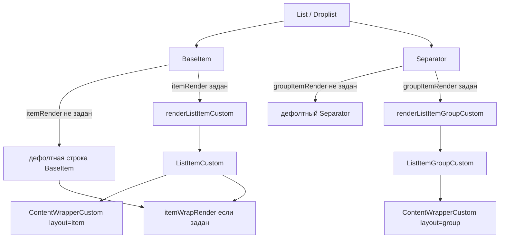

# ListCustom — устройство и логика

Спецификация кастомных оболочек строки и заголовка группы для `List` / `Droplist` в хедере. Ось размера мастера — только `s` (Figma `list/anatomy/size/s`).

## Зачем

Стандартный `BaseItem` / `Separator` из `@ds/list` рисуют раскладку списка. Пропы `contentRender` и `itemWrapRender` не позволяют заменить отступы и типографику оболочки строки, не затрагивая остальных потребителей List.

В хедере нужна раскладка мастеров `listItemCustom` / `listItemGroupCustom` / `contentWrapperCustom` (файл Figma `VcK2QJzt2cWJiHzTzpKAuZ`). Для этого в List добавлены опциональные слоты:

| Проп List | Когда задан | Когда не задан |
|-----------|-------------|----------------|
| `itemRender` | вместо JSX строки `BaseItem` | дефолтная разметка `BaseItem` |
| `groupItemRender` | вместо разметки `Separator` | дефолтный `Separator` |

Логика выбора, клавиатуры, вложенных списков и закрытия дроплиста остаётся в List. Оболочки отвечают только за визуальную раскладку и индикаторы выбора (маркер, чекбокс, подложка) по макету хедера.

`contentRender` и `itemWrapRender` не меняют сигнатуру и место в дереве: `itemWrapRender` по-прежнему оборачивает результат `itemRender` (например, ссылка профиля в UserMenu).

## Состав модуля

```
ListCustom/
├── index.ts                    # публичный экспорт
├── renderListCustom.tsx        # адаптеры ItemRenderProps → оболочки
├── specs/readme.md             # этот файл
└── helperComponents/
    ├── ContentWrapperCustom/   # приватный слот before + текст + after
    ├── ListItemCustom/         # публичная оболочка строки
    └── ListItemGroupCustom/    # публичная оболочка группы
```

**Публичный API пакета:** `ListItemCustom`, `ListItemGroupCustom`, `renderListItemCustom`, `renderListItemGroupCustom`. Режим выбора — `MODE` / `Mode` из `@ds/list`.

`ContentWrapperCustom` наружу не экспортируется.

## Поток данных



Подключение в продукте (прямой `List` / `Droplist`):

- `UserMenu` — `itemRender` / `groupItemRender` + `size="s"` на Droplist **только на desktop** (`useMobileLayout`); на mobile-шапке — дефолтный `BaseItem`.
- `Favorites` — то же на дроплисте действий избранного (гейт по пропу `isMobile` из MainMenu).

ListCustom рассчитан на desktop-раскладку хедера. Desktop-only = не передавать оболочки на mobile у потребителя, а не форкать стили `ListItemCustom`.

Типичный вызов с адаптерами хедера (гейт у потребителя):

```ts
import { renderListItemCustom, renderListItemGroupCustom } from '@cloud-ru/ds-uikit-product-header';

<Droplist
  size='s'
  itemRender={isMobile ? undefined : renderListItemCustom}
  groupItemRender={isMobile ? undefined : renderListItemGroupCustom}
  // …
/>
```

### Транзитивные потребители List (проброс API)

Оболочки ListCustom подключаются и там, где `Droplist` спрятан внутри другого пакета. В этих пакетах публичный API дополнен теми же слотами `itemRender` / `groupItemRender` (`Pick` из `DroplistProps`); значения уходят во внутренний `Droplist` и не попадают на триггер. Пакеты **не** гейтят сами — desktop-only делает consumer (например cp/header).

| Пакет | Публичная точка | Куда уходит |
|-------|-----------------|-------------|
| `@cloud-ru/ds-chips` | `ChipChoice.Single`, `ChipChoice.Multiple` (`ChipChoiceSelectCommonProps`) | внутренний `Droplist` списка опций |
| `@cloud-ru/ds-uikit-product-notification` | `NotificationPanelSettings` (`settings` у `NotificationPanel`); `NotificationCard`; `NotificationCardStack` | `NotificationPanelSettingsDroplist` / `ActionsButton` → `Droplist` |

Вне скоупа проброса (календарь / кастомный контент, не List-опции): `ChipChoice.Date`, `Time`, `DateRange`, `Custom`.

Пример для фильтров project-select и панели уведомлений:

```ts
import { ChipChoice } from '@cloud-ru/ds-chips';
import { NotificationPanel } from '@cloud-ru/ds-uikit-product-notification';
import { renderListItemCustom, renderListItemGroupCustom } from '@cloud-ru/ds-uikit-product-header';

const desktopListCustom = !isMobile
  ? { itemRender: renderListItemCustom, groupItemRender: renderListItemGroupCustom }
  : {};

<ChipChoice.Single
  {...desktopListCustom}
  // …
/>

<NotificationPanel
  settings={{
    actions,
    ...desktopListCustom,
  }}
  // …
/>
```

Плотность (`useDesktopComfortClassName` / `dropDownClassName`) и оболочки ListCustom — разные оси: comfort меняет токены density контейнера; `itemRender` заменяет разметку строки по макету хедера.

## ContentWrapperCustom (приватный)

Общий внутренний блок `beforeContent` + текст + `afterContent`. Аналог связки `contentWrapper` + `ItemContent` списка: gap `primitive/6`, для `layout=item` вертикальный/горизонтальный padding — anatomy `list/size/s` (`contentWrapper-paddingVertical` / `textContent-paddingHorizontal`), чтобы `droplistSize='s'` давал ту же высоту строки, что дефолтный `BaseItem`.

| Проп | Назначение |
|------|------------|
| `layout` | `'item'` — строка списка; `'group'` — заголовок группы (другие отступы и типографика) |
| `label` / `caption` / `description` | структурный текст; усечение через `TruncateString` |
| `contentNode` | готовый узел вместо структурного текста (например результат `contentRender`) |
| `beforeContent` / `afterContent` | иконочные / произвольные слоты |
| `selectButton` | кнопка массового выбора в заголовке группы |
| `groupVariant` | `'subtitle'` \| `'subtitleTertiary'` — цвет подписи группы |
| `disabled` | пониженная opacity слотов |

Структурный текст рендерится только если есть `label` и нет `contentNode`. `caption` и `description` показываются только при `layout=item`.

## ListItemCustom

Оболочка строки (Figma `listItemCustom`, узел `17001:42063`). Визуальный аналог `BaseItem`, но индикаторы выбора и state layer собраны внутри по декларативным пропам мастера.

### Пропы выбора (Figma)

| Проп | Значения | Эффект |
|------|----------|--------|
| `selectionMode` | `'none'` \| `'single'` \| `'multiple'` (дефолт `none`; из List приходит явно) | single → маркер; multiple → чекбокс; none — без индикаторов |
| `checked` | `boolean` | выбранность; для single ещё включает activated-подложку |
| `disabled` | `boolean` | курсор, opacity контента, цвет маркера; state layer не рисуется |

Тип пропсов совместим с `ItemRenderProps` из `@ds/list` (`selectionMode` — `Mode` списка).

### Логика индикаторов выбора

```
showMarker   = single && checked && !isParentNode && !switchControl
showCheckbox = multiple && !switchControl

stateLayer   = activatedOnBackground  только если single && checked && !disabled && !isParentNode && !switchControl
             иначе emptyNeutralOnBackground (и только если !disabled)
```

- **single + checked** — вертикальный маркер слева (`primary/accent`; при `disabled` — `neutral/accent` + opacity).
- **multiple** — `Checkbox` size `s` (мастер `checkboxS`), всегда в потоке строки, независимо от `checked`.
- **activated**-подложка только у single-выбранной активной строки; у multiple фон не меняется при выборе.
- Маркер и activated не показываются у parent-строки и при наличии `switchControl` (паритет с правилами `BaseItem`).

Фокус — `outline` на интерактивном `<li>`, без переноса `focusedFrame` из Figma.

### Контент строки

1. Если `contentFromRender` — структурный разбор пропускается, в слот текста идёт `contentNode`.
2. Иначе `content` вида `{ label, caption?, description? }` или примитив → поля в `ContentWrapperCustom`.
3. Слоты снаружи текста: `dragHandle` → маркер/чекбокс → `ContentWrapperCustom` → `switchControl` → `expandIcon`.

Обработчики (`onClick`, `onKeyDown`, …), `itemRef`, `tabIndex`, `data-test-id` вешаются на `<li>`; выбор и клавиатура по-прежнему живут в `BaseItem`, оболочка только принимает уже подготовленные колбэки.

### Вложенность

`level` задаёт CSS-переменную `--level` и атрибуты `data-level-one` / `data-level-more-one` для отступа nesting из токенов списка size `s`.

## ListItemGroupCustom

Оболочка заголовка группы (Figma `listItemGroupCustom`, узел `17001:43680`). Тип пропсов = `GroupItemRenderProps` из `@ds/list`.

### Figma-триада vs API: почему нет `groupVariant: 'divider'`

В мастере Figma у группы три **презентации**: подпись `subtitle`, подпись `subtitleTertiary`, только линия (divider-only). В коде это **не** один enum из трёх значений.

| Ось | API | Роль |
|-----|-----|------|
| Стиль подписи | `groupVariant?: 'subtitle' \| 'subtitleTertiary'` | цвет / вес текста заголовка |
| Линия | `divider?: boolean` | разделитель над/под группой (в оболочке хедера — под заголовком) |

Третий вид макета (только линия) — ветка рендера **`divider: true` без `label`**, а не третье значение `groupVariant`.

Почему так, а не 1:1 с Figma:

1. **Оси ортогональны.** Уже есть кейс «подпись + линия»: `groupVariant: 'subtitle'` и одновременно `divider: true`. Один enum `'divider'` эту композицию не выражает без второго пропа.
2. **Совпадение с `@ds/list`.** `Separator`, `CommonGroupItem` и `GroupItemRenderProps` уже разделяют `groupVariant` и `divider`; оболочка хедера повторяет тот же контракт.
3. **Divider-only — другая структура, не стиль текста.** Без `label` не применяется типографика `subtitle` / `subtitleTertiary`; рисуется только `Divider` (`variant=Regular`). Класть это в `groupVariant` смешивало бы «цвет подписи» и «тип строки».

Итого: в Controls / данных списка достаточно связки **`groupVariant` + `divider`** (+ наличие или отсутствие `label`). Значение `'divider'` в `groupVariant` в API не добавляется.

Ветки рендера:

| Условие | Результат |
|---------|-----------|
| есть `label` | `ContentWrapperCustom` с `layout=group`; при `divider` — ещё `Divider` под заголовком (`Regular` для `subtitle`, `Thin` для `subtitleTertiary`) |
| нет `label`, есть `divider` | только разделитель (`dividerOnly`) |
| иначе | `null` |

`selectButtonNode` из List передаётся в `ContentWrapperCustom` как `selectButton`. Уровень вложенности — тот же механизм `--level`, что у строки.

## Адаптеры `renderList*`

Стабильные функции для пропсов List (ссылка не меняется между рендерами). Оба — прямой spread:

```ts
export function renderListItemCustom(props: ItemRenderProps) {
  return <ListItemCustom {...props} />;
}
export function renderListItemGroupCustom(props: GroupItemRenderProps) {
  return <ListItemGroupCustom {...props} />;
}
```

`BaseItem` кладёт в `ItemRenderProps.selectionMode` значение из `SelectionProvider` (`none` / `single` / `multiple`) и **не** передаёт готовые узлы маркера/чекбокса — их рисует оболочка.

## Связь с List

| Слой | Ответственность |
|------|-----------------|
| `SelectionProvider` / `BaseItem` | режим выбора, значение, клик; сбор `ItemRenderProps` с `selectionMode` |
| `renderListItemCustom` | `<ListItemCustom {...props} />` |
| `ListItemCustom` | раскладка и индикаторы выбора по `selectionMode` / `checked` / `disabled` |
| `itemWrapRender` | опциональная обёртка поверх уже собранной оболочки (ссылка и т.п.) |

Ось `size` у оболочек не дублируется: отступы зашиты под мастер `s`. Потребители в хедере ставят `size="s"` на List/Droplist, чтобы служебные узлы списка (если останутся) совпадали по шкале.

## Стори

| Story | Назначение |
|-------|------------|
| `ListItemCustom.Playground` | Controls: `selectionMode`, `checked`, `disabled`, `asParentGroup`, `asNested` |
| `ListItemCustom.VisualMatrix` | две таблицы: `single` и `multiple`; строки enabled/disabled × колонки unchecked/checked |
| `ListItemGroupCustom.Playground` | Controls: `groupVariant` + `divider` (+ story-only `withLabel` для divider-only) |
| `ListItemGroupCustom.VisualMatrix` | вертикально три презентации Figma: subtitle / subtitleTertiary / divider-only |
| `ListCustom.Playground` | smoke: List + оба рендера (legacy, будет удалена позже) |
| `ListCustom.VisualMatrix` | объединённая матрица (legacy, будет удалена позже) |

## Figma (ориентиры)

| Мастер | Node |
|--------|------|
| `listItemCustom` | `17001:42063` |
| `contentWrapperCustom` | `17001:43602` |
| `listItemGroupCustom` | `17001:43680` |

Варианты строки: `selectionMode` × `checked` × `disabled` (восемь комбинаций single/multiple).
